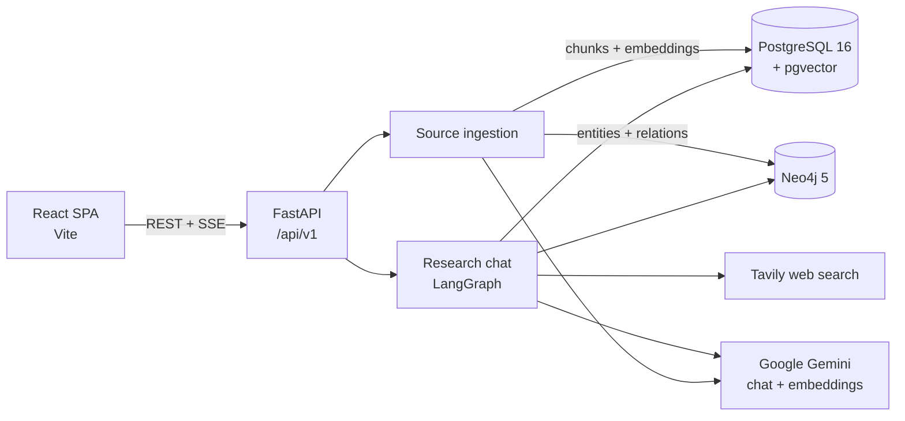
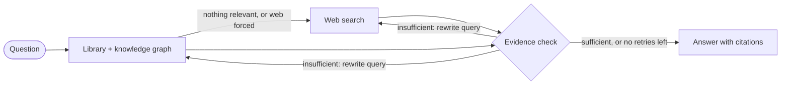

# Dusk: AI Research Workspace

Dusk is a research workspace that answers questions from your own sources. You add web pages, PDF and Word documents, GitHub repositories, YouTube videos or plain text to a library. Dusk indexes them for search and builds a knowledge graph of the concepts they mention. The Copilot then answers questions with citations, searching your library, the graph and, when needed, the web.

## What it does

- **Library.** Add a YouTube video, a GitHub repository or a web page by URL, or upload a file (PDF, Word `.docx`, text or Markdown). A web page link that turns out to be a PDF or Word file is read as that document. Each source is extracted, chunked and embedded (pgvector), and its entities and relations go into a per-user knowledge graph (Neo4j).
- **Research sessions.** Each conversation has its own attached sources and a source policy: answer from sources only, or sources first with the web as a fallback.
- **Copilot chat.** Answers stream in with numbered citations, the evidence quotes behind them, related concepts from the graph, and suggested follow-up questions. A collapsible "Research path" shows every search and retry behind an answer.
- **Knowledge map.** Interactive graph views of everything you've ingested, per source or across your whole library. What you like, explore or are curious about is stored as user memory and used to suggest questions.
- **Accounts.** Email and password, or Google sign-in.

## Architecture

A modular monolith: one React single-page app, one FastAPI service, PostgreSQL for relational data and vectors, and Neo4j for the knowledge graph.



**Ingestion** runs inside the `POST /sources` request: extract text (web page, GitHub repository, YouTube transcript or raw text), chunk it, embed it with Gemini into `source_chunks`, then extract entities and relations into Neo4j. If embedding fails, the source ends in `failed` and can be added again. If graph extraction fails, the source is still indexed.

**Chat** is a corrective RAG pipeline (below), streamed to the browser over Server-Sent Events. Answers, citations and the research trace are saved on the chat message.

### How answers are grounded: corrective RAG

Research chat uses **corrective retrieval-augmented generation**: hybrid retrieval over three sources, plus an evidence check that rewrites the search and switches source when the evidence doesn't answer the question. The pipeline is a LangGraph graph in [`backend/app/agent/`](backend/app/agent/).



1. **Hybrid retrieval.** Each question searches the user's library (pgvector semantic search plus keyword matching) and the knowledge graph (Neo4j entities, their relations, and the documents linked to them). Sources attached to the session or linked through the graph rank higher.
2. **Web fallback.** If nothing in the library is relevant, or the user turns on "Web always", Dusk searches the web with Tavily.
3. **Evidence check.** Before answering, an LLM judges whether the evidence directly answers the question. It judges the evidence only, not its own knowledge. Short conversational messages skip this step.
4. **Query rewriting and source switching.** When the evidence falls short, the same check writes a standalone, more specific query and picks where to run it: the library and graph, or the web. By default it switches away from the source just searched, and it never repeats a search that already ran.
5. **Retry, then answer.** Retrieval runs again with the rewritten query, up to `CHAT_MAX_RETRIEVAL_RETRIES` times (default 2). Evidence from every attempt is merged and de-duplicated. The answer cites each claim, and if the evidence is still thin it says what is missing.

| Setting (`backend/app/core/config.py`) | Default | Effect |
| --- | --- | --- |
| `CHAT_EVIDENCE_GRADING` | `True` | Turns the evidence check, and therefore query rewriting and retries, on or off |
| `CHAT_MAX_RETRIEVAL_RETRIES` | `2` | Extra searches allowed per message after the first |
| `RAG_MIN_SIMILARITY` | `0.55` | Similarity a library passage needs to count as relevant |

Each evidence check is an extra LLM call, counted against the per-user `PIPELINE_LLM_RPM` limit. If the check fails or hits that limit, Dusk answers with the evidence it already has.

**Not covered yet:** the first route (library first, web as a fallback) is a fixed rule rather than a model decision, and the model doesn't call search tools on its own or break questions into sub-questions.

## Tech stack

| Area | Components |
| --- | --- |
| Frontend | React 18, TypeScript, Vite 6, Tailwind CSS 4, Radix UI, TanStack Query, React Router, React Hook Form + Zod, Axios, React Flow (`@xyflow/react`) + `d3-force` for graph views, `react-markdown` for answers |
| Backend | Python 3.12, FastAPI, Pydantic v2, SQLAlchemy 2.0 (async, asyncpg), Alembic, structlog |
| AI | LangGraph, LangChain Google GenAI, Google Gemini (`gemini-2.0-flash` chat, `gemini-embedding-001` embeddings, 768 dimensions) |
| Data | PostgreSQL 16 + pgvector, Neo4j 5 |
| External services | Tavily (web search), GitHub API (repository sources), YouTube transcripts, Google Identity Services (sign-in) |
| Extraction | trafilatura, BeautifulSoup, youtube-transcript-api |
| Auth & security | JWT bearer tokens, bcrypt, per-user rate limits on endpoints and model calls, SSRF checks on fetched URLs |
| Testing & CI | pytest, Ruff, Vitest + Testing Library, ESLint, GitHub Actions |

## Repository layout

```text
backend/
  app/
    api/v1/       REST endpoints: health, auth, users, sources, sessions, chat, knowledge
    agent/        Research chat LangGraph graph (retrieve, evaluate, generate)
    services/     Ingestion, extractors, chunking, embeddings, chat streaming, sessions, auth
    graph/        Neo4j knowledge-graph engine
    memory/       Per-user memory and suggested starter questions
    db/, schemas/ SQLAlchemy models and Pydantic schemas
  alembic/        Database migrations
  tests/          Unit and API tests
frontend/
  src/
    api/          One client module per backend area
    features/     landing, auth, workspace (copilot chat, graph canvas, session flow), theme
    components/   Shared UI primitives
docs/             Architecture, AI workflows, API reference, development guide
```

## Quickstart

You need Docker, a Google AI Studio key (`GEMINI_API_KEY`) and, optionally, a Tavily key for web search.

1. Create the backend environment file and fill in `SECRET_KEY` and `GEMINI_API_KEY`:
   ```bash
   cp backend/.env.example backend/.env
   ```
2. Start everything (PostgreSQL, Neo4j, backend with migrations, frontend):
   ```bash
   docker compose up --build      # or: make up
   ```
3. Open the app at http://localhost:5173. The API is at http://localhost:8000/api/v1, with Swagger at http://localhost:8000/docs.

To run the apps outside Docker, start only the databases with `docker compose up -d postgres neo4j`, then:

```bash
# Backend (Python 3.12+)
cd backend
python -m venv .venv && source .venv/bin/activate   # Windows: .venv\Scripts\Activate.ps1
pip install -r requirements.txt
alembic upgrade head
uvicorn app.main:app --reload --port 8000

# Frontend (Node 20+), in another terminal
cd frontend
npm install
npm run dev
```

Run all tests with `make test` and all linters with `make lint`.

## Documentation

- [docs/architecture.md](docs/architecture.md): system design, database schema, security, state machines
- [docs/ai-workflows.md](docs/ai-workflows.md): the chat pipeline, streaming events and tuning settings
- [docs/api.md](docs/api.md): endpoint reference
- [docs/evaluation.md](docs/evaluation.md): RAGAS metrics, synthetic test sets, offline runs and production quality monitoring
- [docs/development.md](docs/development.md): environment variables, Google sign-in setup, migrations, testing
