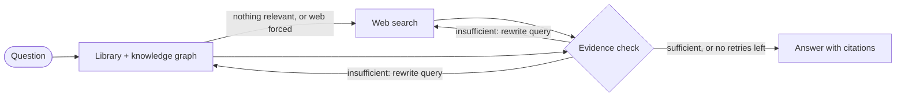

# AI Research Workspace

An intelligent workspace designed for deep, autonomous research. 
Powered by LangGraph and Google Gemini.

## Overview

The AI Research Workspace is a unified environment where you can:
1. **Ingest** documents, URLs, and text into a structured workspace.
2. **Retrieve** context from your library (pgVector), a knowledge graph (Neo4j) and the live web.
3. **Research** questions autonomously via a multi-agent LangGraph workflow.
4. **Review** cited, markdown-formatted reports backed by hard evidence.

## How answers are grounded: corrective RAG

Research chat uses **corrective retrieval-augmented generation**: hybrid retrieval over three sources, plus an evidence check that rewrites the search and switches source when the evidence doesn't answer the question. The pipeline is a LangGraph graph in [`backend/app/agent/`](backend/app/agent/).



1. **Hybrid retrieval.** Each question searches the user's library (pgVector semantic search plus keyword matching) and the knowledge graph (Neo4j entities, their relations, and the documents linked to them). Library sources attached to the session or linked through the graph rank higher.
2. **Web fallback.** If nothing in the library is relevant, or the user turns on "Web always", Scout searches the web (Tavily).
3. **Evidence check.** Before answering, an LLM judges whether the evidence directly answers the question. It judges the evidence only, not its own knowledge. Short conversational messages skip this step.
4. **Query rewriting and source switching.** When the evidence falls short, the same check writes a standalone, more specific query and picks where to run it: the library and graph, or the web. By default it switches away from the source just searched, and it never repeats a search that already ran.
5. **Retry, then answer.** Retrieval runs again with the rewritten query, up to `CHAT_MAX_RETRIEVAL_RETRIES` times (default 2). Evidence from every attempt is merged and de-duplicated. The answer cites each claim, and if the evidence is still thin it says what is missing.

The chat streams each step as it happens: every search, the evidence verdict, and any retry with its rewritten query and source. Each answer stores its research trace, which the UI shows as a collapsible "Research path".

**Settings** (in `backend/app/core/config.py`):

| Setting | Default | Effect |
| --- | --- | --- |
| `CHAT_EVIDENCE_GRADING` | `True` | Turns the evidence check, and therefore query rewriting and retries, on or off |
| `CHAT_MAX_RETRIEVAL_RETRIES` | `2` | Extra searches allowed per message after the first |
| `RAG_MIN_SIMILARITY` | `0.55` | Similarity a library passage needs to count as relevant |

Each evidence check is an extra LLM call. It isn't run once the retry limit is reached, so a message makes at most `CHAT_MAX_RETRIEVAL_RETRIES` extra calls (2 by default). These share the per-user `PIPELINE_LLM_RPM` limit. If the check fails or hits that limit, Scout answers with the evidence it already has.

**Not covered yet:** the first route (library first, web as a fallback) is a fixed rule rather than a model decision, and the model doesn't call search tools on its own or break questions into sub-questions.

## Architecture

This is a monorepo consisting of:
- **Backend:** FastAPI, SQLAlchemy 2.0, Asyncpg, pgVector, LangGraph, Google GenAI SDK.
- **Frontend:** React, Vite, MUI 9, TanStack Query, React Router, React Hook Form, Zod.

## Quickstart

1. Copy `.env.example` to `.env` and fill in your `GEMINI_API_KEY` and Postgres URL.
2. Start the database:
   ```bash
   docker-compose up -d db
   ```
3. Run migrations:
   ```bash
   cd backend
   alembic upgrade head
   ```
4. Start backend:
   ```bash
   uvicorn app.main:app --reload
   ```
5. Start frontend:
   ```bash
   cd frontend
   npm run dev
   ```

See the `docs/` folder for more detailed architecture and workflow documentation.
